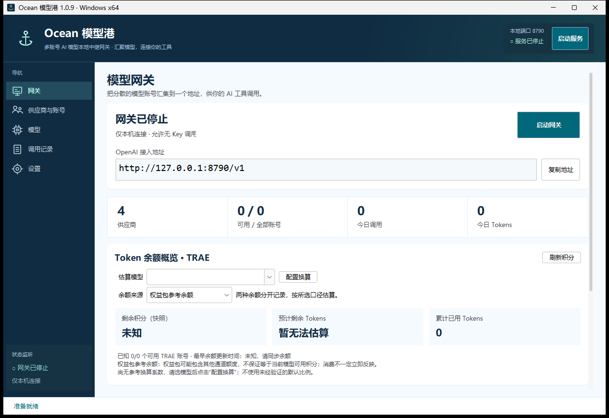
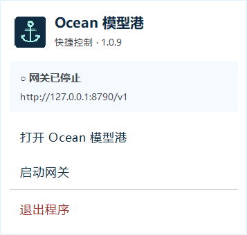

# Ocean 模型港

> **首先感谢原作者夕白（[xibai6668](https://github.com/xibai6668)）和原仓库 [Android-AI-gateway](https://github.com/xibai6668/Android-AI-gateway)。** 原项目的多供应商接入、多账号管理和协议转换是本 Windows 版的技术基础。感谢原作者与社区以 MIT 许可证分享代码；欢迎前往原仓库 Star、反馈问题和参与贡献。

Ocean 模型港是一款 Windows 多账号 AI 模型网关，将多个模型服务通过统一的本地接口接入 ZCode 等 AI 客户端，提供账号管理、模型目录、调用记录和系统托盘控制。

本项目是基于原仓库的 **Windows 移植与界面定制版本**，复用上游 Kotlin/JVM 核心和协议测试。上游基线：[15e42951f7ee4a661fc4b2056d8e1f1c1ef133ce](https://github.com/xibai6668/Android-AI-gateway/commit/15e42951f7ee4a661fc4b2056d8e1f1c1ef133ce)。完整来源与致谢见 [ACKNOWLEDGEMENTS.md](ACKNOWLEDGEMENTS.md)，原作者版权与 MIT 许可证保留在 [LICENSE](LICENSE)。



## 下载与使用教程

- [下载最新版 Windows 客户端](https://github.com/ttg6/Ocean-Model-Harbor/releases/latest)：选择发布附件中的 `Customer.zip`，同时提供 SHA256 校验文件。
- [完整中文使用教程](docs/Customer-Tutorial.txt)：账号登录、多账号添加、模型选择、ZCode 接入、代理与常见报错。
- [快速开始](docs/Customer-Quick-Start.txt) · [开源致谢](ACKNOWLEDGEMENTS.md) · [Windows 移植说明](docs/WINDOWS-PORT.md)

## 运行便携版

支持 Windows 10 / 11 x64。完整解压客户 ZIP，进入 `Ocean 模型港` 文件夹，双击 `Ocean 模型港.exe`。整个文件夹都需要保留，内含运行环境，无需安装 Java。包内附有 `使用教程.txt`、`开源致谢.txt` 和原项目许可证。

1. 打开「供应商与账号」，选择供应商并登录：Trae、Antigravity 使用系统浏览器回调；WorkBuddy 使用浏览器授权并自动轮询；Loomy 使用短信验证码。也可以粘贴凭证 JSON 导入。
   Trae 的「浏览器登录」直接打开官方授权页，可以逐个添加不同账号。添加其他账号前，请在浏览器中退出当前 Trae 账号并切换登录；同一账号重复授权会更新原账号。新用户可使用独立的「TRAE 邀请注册」按钮（邀请码 `BX52NUATZKGF`），注册后点击「继续授权」将账号接入网关。取消邀请注册则不启动本地授权监听。
2. 对自定义 OpenAI 兼容中转站，填写 Base URL、API Keys 和模型名；「读取上游模型目录」可自动填写模型列表。
3. 回到「网关」启动服务，在「模型」页刷新并复制模型 ID。
4. 在客户端中选择 **OpenAI Chat Completions** 协议，Base URL 填 `http://127.0.0.1:8790/v1`，添加并选择复制的完整模型 ID。默认允许无 Key 调用，API Key 可填 `sk-local-gateway`；关闭无 Key 调用后，填写自己保存的网关 Key。修改端口后以首页实际地址为准。

关闭窗口后程序留在系统托盘；双击海锚图标打开窗口，右键在图标旁弹出中文快捷控制窗口，可启动或停止网关。点击外部或按 Esc 收起，选择「退出程序」关闭网关。需要打开应用后自动启服务，可在设置中开启；这不等同于 Windows 开机自启。

Antigravity 首次使用需在「供应商与账号 → 更多操作 → Antigravity OAuth 配置」填写自己有权使用的 Google 桌面应用 Client ID / Client Secret，再点击浏览器登录。本项目不内置上游应用的 OAuth 凭据，配置在本机加密保存。更换 OAuth 客户端后需要重新授权；OAuth 配置本身不赋予上游服务权限。详见 [配置说明](docs/ANTIGRAVITY-OAUTH.md)。




## Token 余额概览

Windows 1.0.9 增加 TRAE 积分快照、按所选模型预计剩余 Tokens 和累计已用 Tokens。权益包与最近对话计费余额分别保存，防止刷新时混用口径；只汇总可用 TRAE 账号，标明未知账号、失败刷新和最早余额更新时间。换算系数按模型手动配置并注明依据，没有可靠比例时不生成数字。详细步骤与限制见 [Token 余额说明](docs/TOKEN-BUDGET.md)。

## 已移植功能

- `/v1/chat/completions`：JSON、SSE 流式、多模态与工具调用的核心转换。
- `/v1/models`、`/v1/credits`、Gemini 原生 `/v1beta/models/*:generateContent`。
- Trae、WorkBuddy（国内 / 国际）、Antigravity、Loomy、自定义 OpenAI 中转站。
- 多账号管理、凭证更新、额度查询、签到、任务列表和任务奖励操作。
- 模型搜索、复制、延迟测试、智能路由、同模型故障转移及高级配置编辑。
- HTTP / SOCKS5 代理；国内上游和本地地址按原核心规则直连。
- 调用统计、请求详情、日志保留与过期清理。
- Windows 系统托盘、同一数据目录单实例、DPAPI 加密存储。

## 接入与数据

默认仅监听本机。若开启「允许局域网连接」，Windows 防火墙可能需要允许该应用的入站连接；局域网地址可在首页接入地址的提示中查看。可设置网关 API Key 并关闭无 Key 调用。监听端口和局域网开关修改后，运行中的服务会重新启动。

为兼容更名前的版本，默认数据路径继续使用 `%LOCALAPPDATA%\AI Gateway Windows`，已有账号与设置会继续加载。所有账号、配置和调用记录使用当前 Windows 用户的 DPAPI 加密。备份可复制这个目录，恢复应使用原 Windows 用户与机器；便携运行的是程序，凭据不承诺跨机器迁移。

启动参数：

```powershell
& '.\Ocean 模型港.exe' --start
& '.\Ocean 模型港.exe' --data 'D:\Ocean Model Harbor Data'
```

也可用 `AIGW_DATA` 环境变量设置数据目录。GUI 无法直接导入 Android 加密存储，需要重新登录或导入各供应商支持的凭证格式。

## 从源码构建

首次构建会下载 JDK 17 和 Gradle 8.12.1 到项目 `.tools`，不修改系统 Java 安装。

```powershell
powershell -ExecutionPolicy Bypass -File .\scripts\Bootstrap.ps1
powershell -ExecutionPolicy Bypass -File .\scripts\Build-Windows.ps1
```

构建默认先跑 `:core:test`、`:desktop:test`，再使用 `jpackage` 生成自带 Java 运行环境的 EXE 文件夹和 ZIP。输出在 `dist`。本地开发可使用下载的 Gradle 执行 `:desktop:run`。

生成包含中文使用教程与致谢的客户包：

```powershell
powershell -ExecutionPolicy Bypass -File .\scripts\Package-Customer.ps1
```

当前本地验证：核心 308 项、Windows 15 项，共 323 项测试通过。覆盖协议转换、JSON / SSE 转发、DPAPI、实际网关启停、导航与设置交互，以及托盘焦点、Esc 和外部点击关闭。客户包的文件通过逐项哈希校验，发布 EXE 的托盘右键已在 Windows 11 上实测。

结构：`core` 是上游 JVM 核心；`desktop` 是 Windows 桌面界面和加密存储；`scripts` 包含构建工具初始化与打包脚本。原始架构说明见 `docs/UPSTREAM-ARCHITECTURE.md`；移植说明与验证记录见 `docs/WINDOWS-PORT.md`。

真实供应商登录和额度依赖用户账号、网络及上游服务，自动化测试使用本地模拟上游。交付时不会预置账号，也不代表获得无限额度。Android 的控制中心磁贴、WakeLock 和前台服务由 Windows 托盘常驻流程替代。当前交付为便携 ZIP，未提供安装向导或 Windows 服务安装。

## 许可

本项目沿用原项目 MIT 许可证，并保留原始版权声明 `Copyright (c) 2026 夕白`。第三方运行库和内置运行环境的许可见 [THIRD-PARTY-NOTICES.md](THIRD-PARTY-NOTICES.md) 及便携版中的 `runtime/legal`。

再次感谢 [Android-AI-gateway](https://github.com/xibai6668/Android-AI-gateway) 的原作者与贡献者。Windows 移植及本仓库界面相关问题可在本仓库反馈。
